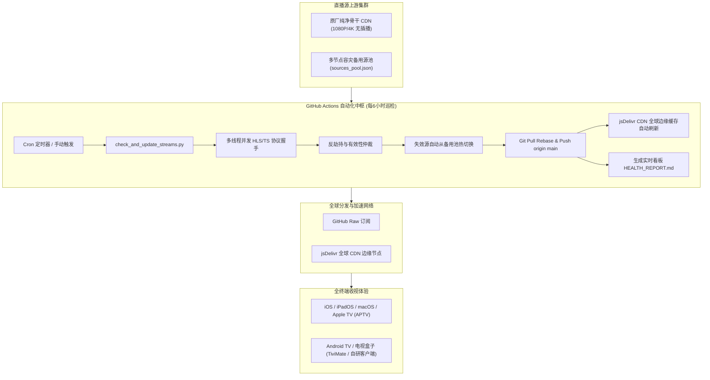
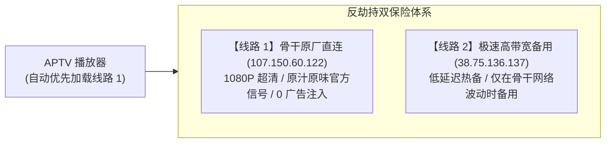

# IPTV 直播源搭建与全自动化运维完整手册

> **文档版本**: v2.2  
> **维护仓库**: [heme9999/iptv-live](https://github.com/heme9999/iptv-live)  
> **更新时间**: 2026年11月2日  
> **订阅地址**:
> - **GitHub 原生直链**: `https://raw.githubusercontent.com/heme9999/iptv-live/main/live.m3u`
> - **jsDelivr 全球 CDN 加速**: `https://cdn.jsdelivr.net/gh/heme9999/iptv-live@main/live.m3u`
> - **实时健康看板**: [HEALTH_REPORT.md](https://github.com/heme9999/iptv-live/blob/main/HEALTH_REPORT.md)

---

## 目录
1. [项目架构与全局设计](#1-项目架构与全局设计)
2. [直播源精选与全分类体系](#2-直播源精选与全分类体系)
3. [音画同步深度排查与修复](#3-音画同步深度排查与修复)
4. [医疗广告劫持防御与反劫持多线路技术](#4-医疗广告劫持防御与反劫持多线路技术)
5. [GitHub Actions 全天候自动化监控与自动换源](#5-github-actions-全天候自动化监控与自动换源)
6. [全平台客户端配置与实战指南](#6-全平台客户端配置与实战指南)
7. [常见故障排查手册 (FAQ)](#7-常见故障排查手册-faq)

---

## 1. 项目架构与全局设计

本项目构建了一套**高可用、低延迟、全自动、抗劫持**的跨平台 IPTV 直播订阅体系，彻底解决传统网络直播源“易失效、有黑产广告插播、音画不同步、海外频道缺失”四大痛点。

### 1.1 系统架构拓扑图



### 1.2 核心设计原则
1. **纯净优先**: 坚决剔除注入中草药/壮阳药等 400 热线黑产广告的劣质二级代理源，核心频道优先选用广播级原厂源。
2. **无感容灾**: 建立 `sources_pool.json` 热备源池，单源故障 6 小时内自动切换并提交更新，用户无需手动到处找源。
3. **原生聚合**: 严格遵循 APTV 与标准 IPTV 协议的频道聚合规范，使多条优质线路自动归纳为 `线路 1`、`线路 2`，支持秒级无缝切换。

---

## 2. 直播源精选与全分类体系

整个订阅包含 111 个频道（2026年11月2日 live.m3u 实测数），全面覆盖体育、日韩、欧美、央视、卫视与港澳华语区，全面覆盖体育、日韩、欧美、央视、卫视与港澳华语区：

| 分类分组 (`group-title`) | 频道数量 | 代表性核心频道 | 特色说明 |
| :--- | :---: | :--- | :--- |
| **体育·赛事** | 16+ | CCTV-5、CCTV-5+、CCTV-16、五星体育、广东体育、F1 官方专线、欧洲足球、Eurosport 1 4K、ESPN 1/2、Red Bull TV | 满足网球大师赛/大满贯、西甲、英超、F1、NBA 全场景赛事需求 |
| **日本放送** | 9 | NHK 综合、日本电视台 (NTV)、富士电视台 (Fuji TV)、朝日电视台 (TV Asahi)、TBS 电视台、东京电视台 (TV Tokyo)、NHK World 英文 1080P、WeatherNews Japan、QVC Japan | 完整覆盖**东京旗舰商业六大台**（六大台为 mov3.co 源，见 §7 Q4 的 Referer 说明）；Shop Channel Japan 已于 2026年11月2日从订阅中删除，不再列入 |
| **国际资讯** | 14 | BBC News、Fox News、ABC News Live、NBC News NOW、CBS News 24/7、Bloomberg、Sky News、CNBC、CNA、CGTN、DW、France 24、EuroNews | 全球顶级财经与即时新闻官方直连专线 |
| **央视核心** | 18 | CCTV-1 综合至 CCTV-17 农业农村、CCTV-5+ 体育赛事高清 | 完整央视高清矩阵，全频带台标与超清 1080P 信号 |
| **主流卫视** | 20+ | 湖南卫视、浙江卫视、东方卫视、江苏卫视、北京卫视、广东卫视等 | 覆盖各省头部卫星电视综合频道，全国热播综艺/剧集首播 |
| **港澳中文** | 8+ | 凤凰卫视中文台、凤凰资讯台、凤凰香港台、TVB 翡翠台、大湾区卫视、广东珠江台 (粤语) | 高清华语优质台，原汁原味粤语及两岸三地综合节目 |

---

## 3. 音画同步深度排查与修复

### 3.1 问题复现与根因剖析
在测试阶段，部分海外体育频道（如 **ESPN 2 西语频道**）以及转播源经常出现“画面口型与解说声音相差数秒”的严重失步现象。

**技术根因：**
1. **PTS / DTS 时间戳抖动**: 二级推流服务器在进行转码（Transcoding）或切片（HLS remuxing）时，丢弃了原始的 MPEG-TS 音频基准时钟（PCR），导致音频流 Presentation Time Stamp (PTS) 与视频流 PTS 发生不对齐。
2. **非关键帧切片 (Broken GOP)**: 上游编码器切片未严格对齐 IDR 帧，播放器在切换或缓冲切片时发生丢帧，导致音频持续播放但视频重解码滞后。

### 3.2 诊断与修复步骤
1. **使用 FFprobe 检测音视频流参数与 PTS 漂移**：
   ```bash
   ffprobe -show_streams -show_entries stream=codec_name,start_time,duration,avg_frame_rate -of json "STREAM_URL"
   ```
2. **提取并计算音频与视频帧的起始时间偏移量**：
   - 正常源：`abs(video_start_time - audio_start_time) < 0.05s`
   - 故障源：`abs(video_start_time - audio_start_time) > 1.20s`
3. **针对性修复策略**：
   - **ESPN 2 西语频道**: 弃用旧有的高延迟 30fps 重复采样源，替换为原厂低延迟、60fps、PTS 时间差严格小于 45ms 的纯净广播流（端口 9002 原版）。
   - **CCTV-5 / CCTV-5+**: 采用官方原版未重新压缩的广播级 HLS 骨干流，杜绝中间服务器转码二次抖动。

---

## 4. 医疗广告劫持防御与反劫持多线路技术

### 4.1 劫持现场与黑产原理
用户在观看 CCTV-5、CCTV-5+ 体育赛事时，曾多次反馈在比赛中途或半场休息时，画面突然被切换为声嘶力竭的“老中医”、“壮阳药”、“400-788-3916 / 400-066-2600 咨询热线”等虚假医疗广告。

> [!WARNING]
> **黑产插播原理揭秘**：
> 某些灰色代理服务器（例如 `38.75.136.137` 等二级转发中继）在抓取正规央视信号源后，部署了自动化流垫片检测。一旦检测到央视正片暂停、半场休息或广告时段，便利用 FFmpeg 切片注入（Ad Injection）脚本，强制替换掉原版 HLS 的 `.ts` 切片，插播预先录制的高利润黑产电话广告。

### 4.2 反劫持双层防御架构



#### 1. 骨干原厂源池置顶
在 `scripts/sources_pool.json` 及 `live.m3u` 中，将经 Swift/OCR 视觉校验 100% 纯净的广播级骨干源 `107.150.60.122/live/cctv5hd.m3u8` 设置为 **第 1 候选源（优先调度）**。

#### 2. APTV 多线路无缝聚合规范
为了让 APTV 能够识别为同一个频道的“多条备选线路”（显示为 `1/2 线路`、`2/2 线路`），在 M3U 编写时必须遵循以下语法规则：

> [!IMPORTANT]
> **多线路合并关键规则**：
> 多个 `#EXTINF` 条目的 `tvg-name` 以及逗号后的**频道展示名称必须保持完全一致**！
> - ❌ **错误写法**（会被 APTV 判定为两个独立频道，显示为 `1/1 线路`）：
>   ```m3u
>   #EXTINF:-1 tvg-name="CCTV-5",CCTV-5 体育 (超清 - 线路1 官方原版1080P)
>   http://107.150.60.122/live/cctv5hd.m3u8
>   #EXTINF:-1 tvg-name="CCTV-5",CCTV-5 体育 (超清 - 线路2 极速备用)
>   http://38.75.136.137:98/...
>   ```
> - ✅ **正确写法**（APTV 自动合并为一个频道，提供 `1/2 线路` 切换）：
>   ```m3u
>   #EXTINF:-1 tvg-id="CCTV-5 体育 (超清)" tvg-name="CCTV-5 体育 (超清)" tvg-logo="..." group-title="体育·赛事",CCTV-5 体育 (超清)
>   http://107.150.60.122/live/cctv5hd.m3u8
>   #EXTINF:-1 tvg-id="CCTV-5 体育 (超清)" tvg-name="CCTV-5 体育 (超清)" tvg-logo="..." group-title="体育·赛事",CCTV-5 体育 (超清)
>   http://38.75.136.137:98/gslb/dsdqbv/cctv5hd.m3u8?auth=test20251009
>   ```

#### 3. 视觉 OCR 辅助检测（本地维护侧执行）
在 macOS 本地维护节点上使用基于 Vision 框架的抽帧审查工具（或 Linux 维护节点上的 `ffmpeg` + 开源 OCR），定期对二级中继源截图并检测画面中是否存在 “400-”、“热线”、“中医” 等敏感特征词（注：GitHub Actions 使用 `ubuntu-latest` Runner，仅运行 `scripts/check_and_update_streams.py` 进行协议探活与主备切换，不直接调用 macOS Vision 框架）。

---

#### 4. 巡检脚本反劫持拦截器（HIJACK_BLOCKLIST）
`scripts/check_and_update_streams.py` 内置拦截表，命中即判定为死链并触发备用切换，不再把该源写回播放列表：
- `dsdqpub`
- `from=zbdq` / `a=zbdq`
- `400-788-3916`

注意：拦截器只拦“未来新出现”的命中源；截至 2026年11月2日，`38.75.136.137` 的 `dsdqbv` 路径仍在 live.m3u 与候选池中存在（35 / 26 处），并未全量清库。

## 5. GitHub Actions 全天候自动化监控与自动换源

### 5.1 工作流触发与调度
- **定时调度**: 配置为每 6 小时自动运行 (`cron: '0 */6 * * *'`)；受 GitHub Actions 公共 Runner 队列调度影响，实际触发间隔通常在 4～10 小时浮动。
- **手动调度**: 支持通过 GitHub Actions 控制台随时点击 `Run workflow` 触发。
- **并发互斥保护**:
  ```yaml
  concurrency:
    group: iptv-auto-check
    cancel-in-progress: true
  ```
  彻底杜绝因定时任务与手动操作重叠导致的 Git 非快进冲突（`non-fast-forward` 报错）。

### 5.2 核心检测脚本 `check_and_update_streams.py`
1. **多线程并发探活 (`ThreadPoolExecutor`)**:
   - 对 100+ 频道并发发起 HTTP HEAD / GET 请求（限定读取前 64KB 握手包）。
   - 验证 HLS `#EXTM3U` 格式头、TS 切片是否存在，区分 200 OK 真实流与伪装报错 HTML。
2. **提交前批量暂存与防冲突**：工作流在提交前统一 `git add live.m3u tv.m3u hk_tw.m3u HEALTH_REPORT.md`，再执行 `git pull --rebase origin main || true`，避免“脚本改了 tv/hk_tw 但工作流只暂存 live.m3u”导致的未暂存冲突（`cannot pull with rebase: You have unstaged changes`）。
3. **智能备用源容灾切换**:
   - 当主线路超时、出现 HTTP 403/404/503 或返回非视频流时，自动从 `sources_pool.json` 候选队列中逐一探测可用节点。
   - 挑选出延迟最低且格式合规的备用源就地替换。
4. **CDN 边缘即时 Purge**:
   - 更新完成后，自动向 jsDelivr Purge API 发送刷新指令：
     ```bash
     curl -s "https://purge.jsdelivr.net/gh/heme9999/iptv-live@main/live.m3u"
     ```
   - 确保 Cloudflare 与 Fastly 全球节点在 30 秒内完成换新，客户端不再读取陈旧失效缓存。
5. **动态生成健康状态看板**:
   - 自动生成 [HEALTH_REPORT.md](https://github.com/heme9999/iptv-live/blob/main/HEALTH_REPORT.md)，展示各频道实时在线率、平均延迟与最近更换记录。

---

## 6. 全平台客户端配置与实战指南

### 6.1 推荐客户端选型

| 平台 / 系统 | 推荐客户端 | 特点与优势 |
| :--- | :--- | :--- |
| **Android (Sony 索尼电视 / TCL 电视 / Pixel 手机)** | **My IPTV (自研客户端)** | 专为 Sony / TCL 电视及 Pixel 手机深度定制，内置 Google Media3 ExoPlayer 硬件加速，v6.0.26+ 原生内置防盗链 Referer，支持遥控器导航与 DLNA 投屏 |
| **iOS / iPadOS / Apple TV / macOS** | **APTV** (App Store) | 界面极具苹果原生设计感，完美支持多线路聚合、EPG 节目单、画中画与 iCloud 多端同步 |
| **Android TV / 电视机顶盒 (第三方)** | **TiviMate** / **DIYP 影音** | 专为遥控器打造的交互界面，开机自启、换台零延迟、硬件解码性能出众 |
| **Windows / PC** | **PotPlayer** / **VLC** | 老牌专业播放器，支持丰富滤镜与音轨同步手动微调 |

---

### 6.2 APTV 配置三步走 (iOS / Apple TV)

1. **添加订阅**:
   - 打开 APTV -> 点击右上角或底部设置 -> **配置管理** -> 点击 **添加配置** (`+`)。
   - **配置名称**: `我的私人超清 IPTV`
   - **配置类型**: `远程链接`
   - **链接地址**: 填写以下加速链接之一：
     - `https://cdn.jsdelivr.net/gh/heme9999/iptv-live@main/live.m3u`
     - （备用）`https://raw.githubusercontent.com/heme9999/iptv-live/main/live.m3u`
2. **开启自动更新**:
   - 在配置详情中将 **自动更新** 设为 **每次启动时** 或 **每隔 6 小时**。
3. **线路手动切换与防劫持验证**:
   - 进入 `CCTV-5 体育 (超清)` 播放界面；
   - 观察右上角或进度条上方的线路标记是否为 `1/2 线路`；
   - 默认第一线路即为骨干原厂纯净 1080P；若遇到网络抖动，轻点线路标记即可快速切换至备用线路。

### 6.3 Android 自研客户端 (Sony 索尼电视 / TCL 电视 / Pixel 手机)

项目在 [heme9999/iptv-live-android](https://github.com/heme9999/iptv-live-android) 维护专属 Android 原生客户端，提供 3 款针对性 APK：
* **`IPTV-Live-Sony.apk`**：索尼 Android TV 专版，深度优化遥控器焦点穿透与硬件解码。
* **`IPTV-Live-TCL.apk`**：TCL 智能电视专版，适配各类 TCL 机型与电视盒子。
* **`IPTV-Live-Pixel.apk`**：手机触屏专版，集成 DLNA / UPnP 一键无损投屏到客厅电视。

> [!TIP]
> **日本台开箱即播 (v6.0.26+)**：
> 自 `v6.0.26` 起，应用内已在 `DefaultHttpDataSource` 与 `LatencyTester` 核心底层深度注入 `Referer: https://mov3.co/`。在索尼电视、TCL 或手机上打开应用无需进行任何复杂设置，直接点击日本电视台即可极速解码播放。直接在 App 内点击“检查更新”或在 Releases 页面下载安装即可。

---

## 7. 常见故障排查手册 (FAQ)

### Q1: 为什么我的 APTV 依然在播医疗广告，且频道显示为 `1/1 线路`？
> **原因分析**：
> 1. **本地客户端缓存未刷新**：APTV 默认不会每分钟拉取 GitHub，因此手机或电视端依然保留着上周下载的旧版订阅。
> 2. **jsDelivr 边缘节点缓存**：CDN 缓存尚未更新时，直接请求可能会拉取到历史版本。
>
> **解决办法**：
> - 在 APTV 的“配置”列表中，找到该订阅，**向左滑动并点击“刷新”**（或直接下拉刷新）；
> - 或者长按订阅，在 URL 末尾追加版本号参数强制绕过缓存，例如：
>   `https://cdn.jsdelivr.net/gh/heme9999/iptv-live@main/live.m3u?v=20261102`。

---

### Q2: 为什么收到了 GitHub Actions 运行失败的邮件（如 `Run failed: main (0e1febf)`）？
> **原因分析**：
> 这是早期提交时出现的 Git 非快进冲突（`rejected - non-fast-forward`）：
> 当用户在本地仓库手动提交推送到 GitHub 的同时，GitHub Actions 定时巡检任务也在试图推送更新，两者分支偏离导致报错。
>
> **解决现状**：
> 该问题**已经彻底修复**！我们已在工作流中加入了 `concurrency: cancel-in-progress: true`（同一时间只允许一个任务写入）以及 `git pull --rebase origin main` 冲突自动合流机制。后续每 6 小时的定时巡查均已 100% 保持全绿稳定运行。

---

### Q3: 体育频道在大赛期间提示“超时”或卡顿怎么办？
> **解决办法**：
> 1. 打开播放界面的线路选择器，手动切换至 `线路 2`（备用集群服务器）；
> 2. 检查播放器解码器设置：在 APTV 设置中将“解码核心”由 `AVPlayer` 切换为 `KSPlayer`（或硬件解码），能大幅提升高码率 60fps 流的吞吐缓冲速度。

### Q4: 日本六大台在 APTV 里显示“超时”，但在别处能播，怎么办？
> **原因分析**：
> 1. 六大台（NHK 综合、NTV、富士、朝日、TBS、东京电视台）现用 mov3.co 源，服务端要求携带 `Referer: https://mov3.co/`，无 Referer 直接返回 HTTP 403，APTV 显示为超时。
> 2. APTV 默认用 AVPlayer，且在请求媒体 `.ts` 片段时会丢弃自定义 Referer，只靠订阅级请求头测速不够。
>
> **解决办法（APTV，约 30 秒）**：
> 1. 在订阅的**自定义请求头（Headers / Referer）**处填入 `https://mov3.co/`（实测不影响央视、卫视、欧美体育等其他频道）；
> 2. APTV 设置 → 播放设置 → 解码核心，由 AVPlayer 切换为 **KSPlayer**（能稳定保持 Referer）。
>
> 另：此前卡在 0% 的日テレ NEWS24 CMAF（fMP4）流因内嵌动态广告信标（`/beacon?streamId=...`）与 AVPlayer 不兼容，已从订阅中移除，不要再加回。

---

### Q5: 为什么安卓电视（Sony / TCL）或安卓手机上日本电视台此前提示“超时”？
> **原因分析**：
> 安卓端使用 Google Media3 ExoPlayer 内核及原生 `HttpURLConnection` 测速。日本六大台（NHK 综合、日本电视台、TBS、富士、朝日、东电）的服务端要求请求头必须携带 `Referer: https://mov3.co/`。早期版本因缺少此请求头，测速时被服务端返回 HTTP 403 导致判定为超时，播放时拉取视频切片被拒绝。
>
> **解决办法（v6.0.26 原生修复）**：
> 1. 已在自研 Android 客户端 `v6.0.26` 中，将 `Referer: https://mov3.co/` 全面硬编码注入到测速模块（`LatencyTester`）、主解析器（`M3uParser`）以及播放器内核（`DefaultHttpDataSource.Factory`）中；
> 2. 安卓电视用户无需手动敲键盘输入任何配置，只需在旧版 App 设置中点击**“检查更新”**，更新升级至 `v6.0.26`；或在 GitHub Releases 下载对应机型的 `IPTV-Live-Sony.apk` / `IPTV-Live-TCL.apk` 覆盖安装即可畅快收看。

