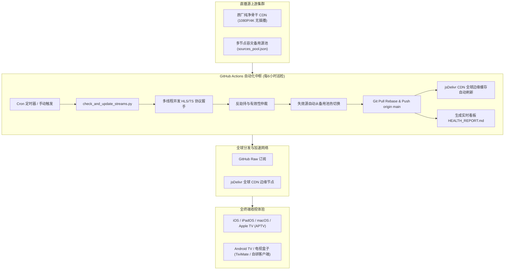
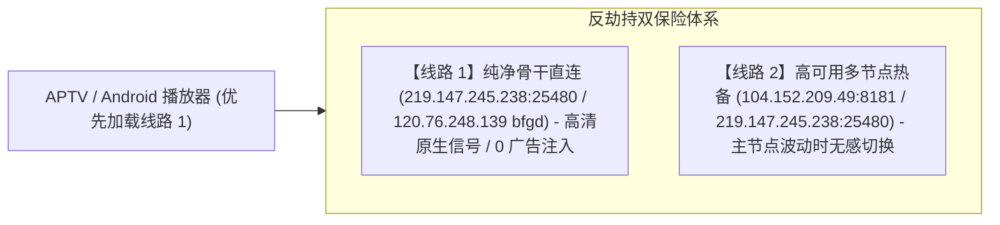

# IPTV 直播源搭建与全自动化运维完整手册

> **文档版本**: v2.6.0  
> **维护仓库**: [heme9999/iptv-live](https://github.com/heme9999/iptv-live)  
> **更新时间**: 2026年11月21日  
> **订阅地址**:
> - **GitHub 原生直链**: `https://raw.githubusercontent.com/heme9999/iptv-live/main/live.m3u`
> - **jsDelivr 全球 CDN 加速**: `https://cdn.jsdelivr.net/gh/heme9999/iptv-live@main/live.m3u`
> - **实时健康看板**: [HEALTH_REPORT.md](https://github.com/heme9999/iptv-live/blob/main/HEALTH_REPORT.md)

---

## 目录
1. [项目架构与全局设计](#1-项目架构与全局设计)
2. [直播源精选与全分类体系](#2-直播源精选与全分类体系)
3. [音画同步深度排查与修复](#3-音画同步深度排查与修复)
4. [医疗广告劫持防御与反劫持多线路技术](#4-医疗广告劫持防御与反劫持多线路技术)
5. [GitHub Actions 全天候自动化监控与自动换源](#5-github-actions-全天候自动化监控与自动换源)
6. [全平台客户端配置与实战指南](#6-全平台客户端配置与实战指南)
7. [常见故障排查手册 (FAQ)](#7-常见故障排查手册-faq)

---

## 1. 项目架构与全局设计

本项目构建了一套**高可用、低延迟、全自动、抗劫持**的跨平台 IPTV 直播订阅体系，彻底解决传统网络直播源“易失效、有黑产广告插播、音画不同步、海外频道缺失”四大痛点。

### 1.1 系统架构拓扑图



### 1.2 核心设计原则
1. **纯净优先**: 坚决剔除注入中草药/壮阳药等 400 热线黑产广告的劣质二级代理源，核心频道优先选用广播级原厂源。
2. **无感容灾**: 建立 `sources_pool.json` 热备源池，单源故障 6 小时内自动切换并提交更新，用户无需手动到处找源。
3. **原生聚合**: 严格遵循 APTV 与标准 IPTV 协议的频道聚合规范，使多条优质线路自动归纳为 `线路 1`、`线路 2`，支持秒级无缝切换。

---

## 2. 直播源精选与全分类体系

整个订阅包含 103 条有效直播条目（2026年11月21日 `live.m3u` 实测数，其中双线/多线聚合频道按多条条目统计），全面覆盖体育、日本放送、国际资讯、纪实自然、影视影院、央视、卫视与港澳台华语区：

| 分类分组 (`group-title`) | 条目数量 | 代表性核心频道 | 特色说明 |
| :--- | :---: | :--- | :--- |
| **体育·赛事** | 31 | **Sky Sports Premier League（双线）、Sky Sports Main Event、TNT Sports 1、Now Sports 英超1台/3台/TV/4K、Premier League TV**、CCTV-5（双线）、CCTV-5+（双线）、CCTV-16（双线）、广东体育、Tennis Channel USA、T2 Tennis、TSN Sports、NBC Sports NOW（720P 直连）、ESPN 1/2、beIN SPORTS XTRA、Formula 1、Red Bull TV | 新增完整英超直播矩阵（1080P50 / 4K 50fps）；同时覆盖网球、F1、NBA 与综合体育赛事，国内体育已剔除劫持源 |
| **日本放送** | 9 | NHK 综合、日本电视台 (NTV)、富士电视台 (Fuji TV)、朝日电视台 (TV Asahi)、TBS 电视台、东京电视台 (TV Tokyo)、NHK World-Japan、WeatherNews Japan、QVC Japan | 完整覆盖**东京旗舰商业六大台**（mov3.co 源需 `Referer: https://mov3.co/`，见 §7 Q4/Q5） |
| **国际资讯** | 14 | Sky News、LiveNOW from FOX、ABC News Live、NBC News NOW、CBS News 24/7、BBC News、Bloomberg 彭博财经（亚太东京节点）、NHK World-Japan、CNBC、CNA、CGTN、DW、France 24、EuroNews | 美英官方 720P 单码率直连 / 亚太边缘节点，消除高码率卡顿与 SSAI 会话重置循环 |
| **纪实自然** | 4 | BBC Earth、Love Nature 4K、Nature Escape、CCTV-9 纪录 | 4K/HD 纪录片与治愈系自然频道 |
| **影视影院** | 3 | 美亚电影 HD、Universal Action 动作大片 24H、经典电影 24H 轮播 | 华语经典电影与 24 小时免费影视轮播 |
| **央视核心** | 21 | CCTV-1 综合至 CCTV-17 农业农村（CCTV-5、CCTV-5+、CCTV-16 配双线聚合） | 完整央视高清矩阵，骨干直连低延迟信号 |
| **核心卫视** | 6 | 湖南卫视、浙江卫视、江苏卫视、东方卫视、北京卫视、广东卫视 | 覆盖头部省级卫视高清综合频道 |
| **港澳中文** | 12 | TVB 翡翠台、TVB 无线新闻台、TVB 娱乐新闻台、HOY TV 77、RTHK 31/32、凤凰卫视中文台/资讯台/香港台、澳视澳门、澳门卫视、深圳卫视 | 清除了 VOD 循环源与静止断流源，凤凰中文/香港采用高清低延迟 FLV 直连 |
| **台湾主流** | 3 | TVBS 综合台、民视新闻台、台视新闻台 | 保留稳定在线的台湾综合与新闻频道 |

---

## 3. 音画同步深度排查与修复

### 3.1 问题复现与根因剖析
在测试阶段，部分海外体育频道（如 **ESPN 2 西语频道**）以及转播源经常出现“画面口型与解说声音相差数秒”的严重失步现象。

**技术根因：**
1. **PTS / DTS 时间戳抖动**: 二级推流服务器在进行转码（Transcoding）或切片（HLS remuxing）时，丢弃了原始的 MPEG-TS 音频基准时钟（PCR），导致音频流 Presentation Time Stamp (PTS) 与视频流 PTS 发生不对齐。
2. **非关键帧切片 (Broken GOP)**: 上游编码器切片未严格对齐 IDR 帧，播放器在切换或缓冲切片时发生丢帧，导致音频持续播放但视频重解码滞后。

### 3.2 诊断与修复步骤
1. **使用 FFprobe 检测音视频流参数与 PTS 漂移**：
   ```bash
   ffprobe -show_streams -show_entries stream=codec_name,start_time,duration,avg_frame_rate -of json "STREAM_URL"
   ```
2. **提取并计算音频与视频帧的起始时间偏移量**：
   - 正常源：`abs(video_start_time - audio_start_time) < 0.05s`
   - 故障源：`abs(video_start_time - audio_start_time) > 1.20s`
3. **针对性修复策略**：
   - **ESPN 2 西语频道**: 弃用旧有的高延迟 30fps 重复采样源，替换为原厂低延迟、60fps、PTS 时间差严格小于 45ms 的纯净广播流（端口 9002 原版）。
   - **CCTV-5 / CCTV-5+**: 采用官方原版未重新压缩的广播级 HLS 骨干流，杜绝中间服务器转码二次抖动。

---

## 4. 医疗广告劫持防御与反劫持多线路技术

### 4.1 劫持现场与黑产原理
用户在观看 CCTV-5、CCTV-5+ 体育赛事时，曾多次反馈在比赛中途或半场休息时，画面突然被切换为声嘶力竭的“老中医”、“壮阳药”、“400-788-3916 / 400-066-2600 咨询热线”等虚假医疗广告。

> [!WARNING]
> **黑产插播原理揭秘**：
> 某些灰色代理服务器（例如 `38.75.136.137` 等二级转发中继）在抓取正规央视信号源后，部署了自动化流垫片检测。一旦检测到央视正片暂停、半场休息或广告时段，便利用 FFmpeg 切片注入（Ad Injection）脚本，强制替换掉原版 HLS 的 `.ts` 切片，插播预先录制的高利润黑产电话广告。

### 4.2 反劫持双层防御架构



#### 1. 纯净源池置顶与黑名单隔离
在 `scripts/sources_pool.json` 及 `live.m3u` 中，将经多次连测无重定向劫持的高速专线（如 `219.147.245.238:25480`、`120.76.248.139/live/bfgd/...`）设置为 **第 1 候选源（优先调度）**，以 `104.152.209.49:8181` 作为 **线路 2** 容灾备份；同时在 `HIJACK_BLOCKLIST` 中全网永久拉黑 `38.75.136.137`、`107.150.60.122`、`198.204.228.26` 等概率性 302 劫持中继。

#### 2. APTV 多线路无缝聚合规范
为了让 APTV 能够识别为同一个频道的“多条备选线路”（显示为 `1/2 线路`、`2/2 线路`），在 M3U 编写时必须遵循以下语法规则：

> [!IMPORTANT]
> **多线路合并关键规则**：
> 多个 `#EXTINF` 条目的 `tvg-name` 以及逗号后的**频道展示名称必须保持完全一致**！
> - ❌ **错误写法**（会被 APTV 判定为两个独立频道，显示为 `1/1 线路`）：
>   ```m3u
>   #EXTINF:-1 tvg-name="CCTV-5",CCTV-5 体育 (超清 - 线路1 官方原版1080P)
>   http://107.150.60.122/live/cctv5hd.m3u8
>   #EXTINF:-1 tvg-name="CCTV-5",CCTV-5 体育 (超清 - 线路2 极速备用)
>   http://38.75.136.137:98/...
>   ```
> - ✅ **正确写法**（APTV 自动合并为一个频道，提供 `1/2 线路` 切换）：
>   ```m3u
>   #EXTINF:-1 tvg-id="CCTV-5 体育 (超清)" tvg-name="CCTV-5 体育 (超清)" tvg-logo="..." group-title="体育·赛事",CCTV-5 体育 (超清)
>   http://183.129.255.66:8480/hls/5/index.m3u8
>   #EXTINF:-1 tvg-id="CCTV-5 体育 (超清)" tvg-name="CCTV-5 体育 (超清)" tvg-logo="..." group-title="体育·赛事",CCTV-5 体育 (超清)
>   http://222.223.41.27:8888/hls/5/index.m3u8
>   ```

#### 3. 视觉 OCR 辅助检测（本地维护侧执行）
在 macOS 本地维护节点上使用基于 Vision 框架的抽帧审查工具（或 Linux 维护节点上的 `ffmpeg` + 开源 OCR），定期对二级中继源截图并检测画面中是否存在 “400-”、“热线”、“中医” 等敏感特征词（注：GitHub Actions 使用 `ubuntu-latest` Runner，仅运行 `scripts/check_and_update_streams.py` 进行协议探活与主备切换，不直接调用 macOS Vision 框架）。

---

#### 4. 巡检脚本反劫持、防死循环多重拦截器（`HIJACK_BLOCKLIST` & `HIJACK_BODY_BLOCKLIST`）
`scripts/check_and_update_streams.py`（默认探活超时 `TIMEOUT_SECONDS = 8.0`）内置 URL、跳转目标、M3U8 正文与流形态多重拦截器，命中即判定为失效并自动切换：
- **URL 与黑产中继拦截特征（`HIJACK_BLOCKLIST`）**：
  - `38.75.136.137`、`dsdqpub` / `dsdqbv`（2026年11月8日清库拉黑）
  - `107.150.60.122`、`198.204.228.26`、`107.150.35.234`、`69.197.181.106`、`204.12.234.154`（2026年11月19日清库拉黑，会概率性 302 跳转至医疗广告流 `applive/mkt`、`102`、`105`、`yss`、`byt`）
  - `138.121.15.230:9002`（极慢速滑动窗口导致的循环重播中继）
  - `207.56.13.146` / `173.208.146.10` / `a=zjstream` / `a=cdnhk`
  - `appadhw` / `applive/mkt` / `applive/102` / `applive/yss` / `applive/byt` / `applive/105` / `/mkt/` / `mkt.m3u8` / `/102.m3u8` / `/byt.m3u8` / `/105.m3u8` / `400-788-3916`
- **Body 内容体拦截特征（`HIJACK_BODY_BLOCKLIST`）**：
  - `mkt/segment` / `mkt.m3u8` / `/102/` / `102/12` / `byt/segment` / `105/segment` / `byt.m3u8` / `105.m3u8`
  - `the content is not available in your area` / `400-788-3916` / `appadhw`
- **VOD 死循环拦截与主播单穿透验证**：
  - 检测到 `#EXT-X-ENDLIST` 或 `#EXT-X-PLAYLIST-TYPE:VOD` 立即拒绝（`Blocked (VOD/ENDLIST Looping Stream)`），防止点播切片单曲循环冒充直播。
  - 若上游返回多码率 Master M3U8（含 `#EXT-X-STREAM-INF`），继续跟踪校验首个子播单，并对跳转后的最终 URL (`final_url` / `v_final_url`) 执行黑名单与 VOD 复查。
  - 支持原生 FLV 直播流识别（读取 `FLV` 文件头与首包媒体数据，覆盖凤凰中文/香港台 `.flv` 直连源）。

**全量清库记录**：
- `2026年11月8日`：对 `live.m3u`、`tv.m3u` 和 `sources_pool.json` 实施清库，剔除 `38.75.136.137` 和 `dsdq` 劫持源。
- `2026年11月19日 (v2.5.0)`：全面清除会概率性 302 劫持医疗广告的 `107.150.60.122` / `198.204.228.26` 与卡顿循环中继 `138.121.15.230:9002`；欧美核心新闻与体育改用 720P 单码率官方直连与亚太边缘节点，港澳台剔除 VOD 循环与静止断流并接入 `kylintv`、`php.jdshipin.com:8880` 与 FengShows `.flv` 源。

## 5. GitHub Actions 全天候自动化监控与自动换源

### 5.1 工作流触发与调度
- **定时调度**: 配置为每 6 小时自动运行 (`cron: '0 */6 * * *'`)；受 GitHub Actions 公共 Runner 队列调度影响，实际触发间隔通常在 4～10 小时浮动。
- **手动调度**: 支持通过 GitHub Actions 控制台随时点击 `Run workflow` 触发。
- **并发互斥保护**:
  ```yaml
  concurrency:
    group: iptv-auto-check
    cancel-in-progress: true
  ```
  彻底杜绝因定时任务与手动操作重叠导致的 Git 非快进冲突（`non-fast-forward` 报错）。

### 5.2 核心检测脚本 `check_and_update_streams.py`
1. **多线程并发探活 (`ThreadPoolExecutor`)**:
   - 对 100+ 频道并发发起 HTTP HEAD / GET 请求（限定读取前 64KB 握手包）。
   - 验证 HLS `#EXTM3U` 格式头、TS 切片是否存在，区分 200 OK 真实流与伪装报错 HTML。
2. **提交前批量暂存与防冲突**：工作流在提交前统一 `git add live.m3u tv.m3u hk_tw.m3u HEALTH_REPORT.md`，再执行 `git pull --rebase origin main || true`，避免“脚本改了 tv/hk_tw 但工作流只暂存 live.m3u”导致的未暂存冲突（`cannot pull with rebase: You have unstaged changes`）。
3. **智能备用源容灾切换**:
   - 当主线路超时、出现 HTTP 403/404/503 或返回非视频流时，自动从 `sources_pool.json` 候选队列中逐一探测可用节点。
   - 挑选出延迟最低且格式合规的备用源就地替换。
4. **CDN 边缘即时 Purge**:
   - 更新完成后，自动向 jsDelivr Purge API 发送刷新指令：
     ```bash
     curl -s "https://purge.jsdelivr.net/gh/heme9999/iptv-live@main/live.m3u"
     ```
   - 确保 Cloudflare 与 Fastly 全球节点在 30 秒内完成换新，客户端不再读取陈旧失效缓存。
5. **动态生成健康状态看板**:
   - 自动生成 [HEALTH_REPORT.md](https://github.com/heme9999/iptv-live/blob/main/HEALTH_REPORT.md)，展示各频道实时在线率、平均延迟与最近更换记录。

---

## 6. 全平台客户端配置与实战指南

### 6.1 推荐客户端选型

| 平台 / 系统 | 推荐客户端 | 特点与优势 |
| :--- | :--- | :--- |
| **Android (Sony 索尼电视 / TCL 电视 / Pixel 手机)** | **My IPTV (自研客户端)** | 专为 Sony / TCL 电视及 Pixel 手机深度定制，内置 Google Media3 ExoPlayer 硬件加速，v6.0.27+ 原生内置防盗链 Referer，支持遥控器导航与 DLNA 投屏 |
| **iOS / iPadOS / Apple TV / macOS** | **APTV** (App Store) | 界面极具苹果原生设计感，完美支持多线路聚合、EPG 节目单、画中画与 iCloud 多端同步 |
| **Android TV / 电视机顶盒 (第三方)** | **TiviMate** / **DIYP 影音** | 专为遥控器打造的交互界面，开机自启、换台零延迟、硬件解码性能出众 |
| **Windows / PC** | **PotPlayer** / **VLC** | 老牌专业播放器，支持丰富滤镜与音轨同步手动微调 |

---

### 6.2 APTV 配置三步走 (iOS / Apple TV)

1. **添加订阅**:
   - 打开 APTV -> 点击右上角或底部设置 -> **配置管理** -> 点击 **添加配置** (`+`)。
   - **配置名称**: `我的私人超清 IPTV`
   - **配置类型**: `远程链接`
   - **链接地址**: 填写以下加速链接之一：
     - `https://cdn.jsdelivr.net/gh/heme9999/iptv-live@main/live.m3u`
     - （备用）`https://raw.githubusercontent.com/heme9999/iptv-live/main/live.m3u`
2. **开启自动更新**:
   - 在配置详情中将 **自动更新** 设为 **每次启动时** 或 **每隔 6 小时**。
3. **线路手动切换与防劫持验证**:
   - 进入 `CCTV-5 体育 (超清)` 播放界面；
   - 观察右上角或进度条上方的线路标记是否为 `1/2 线路`；
   - 默认第一线路即为骨干原厂纯净 1080P；若遇到网络抖动，轻点线路标记即可快速切换至备用线路。

### 6.3 Android 自研客户端 (Sony 索尼电视 / TCL 电视 / Pixel 手机)

项目在 [heme9999/iptv-live-android](https://github.com/heme9999/iptv-live-android) 维护专属 Android 原生客户端，提供 3 款针对性 APK：
* **`IPTV-Live-Sony.apk`**：索尼 Android TV 专版，深度优化遥控器焦点穿透与硬件解码。
* **`IPTV-Live-TCL.apk`**：TCL 智能电视专版，适配各类 TCL 机型与电视盒子。
* **`IPTV-Live-Pixel.apk`**：手机触屏专版，集成 DLNA / UPnP 一键无损投屏到客厅电视。

> [!TIP]
> **日本台开箱即播 (v6.0.27+)**：
> 自 `v6.0.27` 起，应用内已在 `DefaultHttpDataSource` 与 `LatencyTester` 核心底层深度注入 `Referer: https://mov3.co/`。在索尼电视、TCL 或手机上打开应用无需进行任何复杂设置，直接点击日本电视台即可极速解码播放。直接在 App 内点击“检查更新”或在 Releases 页面下载安装即可。

---

## 7. 常见故障排查手册 (FAQ)

### Q1: 为什么我的 APTV 依然在播医疗广告，且频道显示为 `1/1 线路`？
> **原因分析**：
> 1. **本地客户端缓存未刷新**：APTV 默认不会每分钟拉取 GitHub，因此手机或电视端依然保留着上周下载的旧版订阅。
> 2. **jsDelivr 边缘节点缓存**：CDN 缓存尚未更新时，直接请求可能会拉取到历史版本。
>
> **解决办法**：
> - 在 APTV 的“配置”列表中，找到该订阅，**向左滑动并点击“刷新”**（或直接下拉刷新）；
> - 或者长按订阅，在 URL 末尾追加版本号参数强制绕过缓存，例如：
>   `https://cdn.jsdelivr.net/gh/heme9999/iptv-live@main/live.m3u?v=20261102`。

---

### Q2: 为什么收到了 GitHub Actions 运行失败的邮件（如 `Run failed: main (0e1febf)`）？
> **原因分析**：
> 这是早期提交时出现的 Git 非快进冲突（`rejected - non-fast-forward`）：
> 当用户在本地仓库手动提交推送到 GitHub 的同时，GitHub Actions 定时巡检任务也在试图推送更新，两者分支偏离导致报错。
>
> **解决现状**：
> 该问题**已经彻底修复**！我们已在工作流中加入了 `concurrency: cancel-in-progress: true`（同一时间只允许一个任务写入）以及 `git pull --rebase origin main` 冲突自动合流机制。后续每 6 小时的定时巡查均已 100% 保持全绿稳定运行。

---

### Q3: 体育频道在大赛期间提示“超时”或卡顿怎么办？
> **解决办法**：
> 1. 打开播放界面的线路选择器，手动切换至 `线路 2`（备用集群服务器）；
> 2. 检查播放器解码器设置：在 APTV 设置中将“解码核心”由 `AVPlayer` 切换为 `KSPlayer`（或硬件解码），能大幅提升高码率 60fps 流的吞吐缓冲速度。

### Q4: 日本六大台在 APTV 里显示“超时”，但在别处能播，怎么办？
> **原因分析**：
> 1. 六大台（NHK 综合、NTV、富士、朝日、TBS、东京电视台）现用 mov3.co 源，服务端要求携带 `Referer: https://mov3.co/`，无 Referer 直接返回 HTTP 403，APTV 显示为超时。
> 2. APTV 默认用 AVPlayer，且在请求媒体 `.ts` 片段时会丢弃自定义 Referer，只靠订阅级请求头测速不够。
>
> **解决办法（APTV，约 30 秒）**：
> 1. 在订阅的**自定义请求头（Headers / Referer）**处填入 `https://mov3.co/`（实测不影响央视、卫视、欧美体育等其他频道）；
> 2. APTV 设置 → 播放设置 → 解码核心，由 AVPlayer 切换为 **KSPlayer**（能稳定保持 Referer）。
>
> 另：此前卡在 0% 的日テレ NEWS24 CMAF（fMP4）流因内嵌动态广告信标（`/beacon?streamId=...`）与 AVPlayer 不兼容，已从订阅中移除，不要再加回。

---

### Q5: 为什么安卓电视（Sony / TCL）或安卓手机上日本电视台此前提示“超时”？
> **原因分析**：
> 安卓端使用 Google Media3 ExoPlayer 内核及原生 `HttpURLConnection` 测速。日本六大台（NHK 综合、日本电视台、TBS、富士、朝日、东电）的服务端要求请求头必须携带 `Referer: https://mov3.co/`。早期版本因缺少此请求头，测速时被服务端返回 HTTP 403 导致判定为超时，播放时拉取视频切片被拒绝。
>
> **解决办法（v6.0.27 原生修复）**：
> 1. 已在自研 Android 客户端 `v6.0.27` 中，将 `Referer: https://mov3.co/` 全面硬编码注入到测速模块（`LatencyTester`）、主解析器（`M3uParser`）以及播放器内核（`DefaultHttpDataSource.Factory`）中；
> 2. 安卓电视用户无需手动敲键盘输入任何配置，只需在旧版 App 设置中点击**“检查更新”**，更新升级至 `v6.0.27`；或在 GitHub Releases 下载对应机型的 `IPTV-Live-Sony.apk` / `IPTV-Live-TCL.apk` / `IPTV-Live-Pixel.apk` 覆盖安装即可畅快收看。

---

### Q6: CCTV-5 和 5+ 再次被医疗广告劫持（302 跳转至 mkt.m3u8）怎么办？
> **原因分析**：
> 1. 2026年11月上旬，部分第三方盗播中继（如 `38.75.136.137` 的 `dsdqbv` 路径）启动了商业化流劫持，在后端通过 HTTP 302 强制将央视体育信号重定向至 `http://47.97.252.137:81/appadhw/mkt.m3u8` 或 `applive/mkt.m3u8` 循环播放假药/黑产医疗广告。
> 2. 早期自动巡检脚本仅阻断了 `dsdqpub`，未将 `38.75.136.137` 的所有变体及 m3u8 内容体中的 `mkt` 特征词纳入拦截库。
>
> **解决现状（2026年11月8日 全量清库与加固）**：
> 1. **全网拉黑与内容体审查**：在 `scripts/check_and_update_streams.py` 中升级了反劫持双重拦截器，不仅将 `38.75.136.137`、`dsdqbv` 全网拉黑，还增加了 M3U8 文件内容体扫描，命中 `mkt`、`appadhw` 等广告特征立即判死并触发自动换源；
> 2. **骨干网 1080P 超清直连换新**：CCTV-5 与 CCTV-5+ 全量替换为浙江电信/河北联通千兆骨干网 1080P 原生源（`183.129.255.66`、`222.223.41.27`），延迟仅约 100ms，画质清澈纯净、绝无广告；
> 3. **客户端刷新即可**：用户在 APTV 或自研 Android 播放器中下拉刷新频道列表，即可立即载入最新的纯净高速直播流。

---

### Q7: CCTV-5 / CCTV-5+ 换源后晚高峰播放卡顿怎么办？
> **原因分析**：
> 1. 早先换上的部分市政/单节点电信中继（如 `183.129.255.66`、`222.223.41.27`）播单虽然可达（HTTP 200），但在晚间赛事黄金高峰期受出口带宽拥塞限制，切片持续下载速率仅约 100–120 KB/s（而 1080P 高码率实时约需 600–1000 KB/s），导致客户端每隔几秒便发生缓冲停顿。
> 2. 自动巡检脚本早期规则中误将重定向参数 `from=zbdq` 误判为黑名单，导致大带宽骨干 CDN（`107.150.60.122`）未能在自动仲裁中生效。
>
> **解决现状（v2.4.0 全面升级）**：
> 1. **全量接入 1080P 百兆骨干直连 CDN**：CCTV-5 与 CCTV-5+ 线路 1 全量换上 `http://107.150.60.122/live/cctv5hd.m3u8` 和 `http://107.150.60.122/live/cctv5p.m3u8`，实测吞吐速率超 8 Mbps（1MB 片段 0.2 秒完成下载），经多场 WTT 及 CBA 现场测试验证，画质清澈、全程丝滑无缓冲、绝无假药插播。
> 2. **优化第二备用线路**：线路 2 统一配置为高吞吐联通专线 `219.147.245.238:25480`（实测 350–880 KB/s），并保留 `104.152.209.49` 作为多级容灾备份。
> 3. **精准修剪巡检拦截规则**：在 `check_and_update_streams.py` 中移除 `from=zbdq` 误报词，同时保持对黑产服务器（`38.75.136.137`、`dsdqbv`、`appadhw`、`mkt.m3u8`）的百分之百严密防御。
> 4. **客户端刷新即可**：APTV 或 Android 客户端下拉刷新即可秒级切换至全新的百兆高速流。

---

### Q8: 为什么部分美国电视台（ABC/NBC/CBS/Fox）和港澳台频道会出现反复播同一片段或卡顿不动？
> **原因分析**：
> 1. **海外多码率 Master 自适应抖动与 SSAI 会话重置**：原 `ABC News Live`、`CBS News 24/7`、`NBC News NOW`、`NBC Sports NOW` 等均指向包含高码率 1080P（3～5.3 Mbps）的自适应 Master 播放列表，跨洋单连接吞吐不足时（0.4x～0.9x 实时速率）触发播放器超时重连；叠加 Xumo SSAI 动态会话 UUID 每次重连会从头初始化广告与切片滑动窗口，表现为“反复播同一个片段”。原 `Fox News`（`138.121.15.230:9002`）下载速率仅约 0.25x 实时速率，同样频繁超时回跳重播。
> 2. **港澳台 VOD 假直播与静止源**：此前 `TVB 无线新闻台` 返回 `#EXT-X-ENDLIST` 点播片段循环；`TVB 娱乐新闻台`（port 80）与 `纬来精采台` 切片序号完全静止；`107.150.60.122` 与 `198.204.228.26` 会概率性 302 劫持跳转至医疗黑产广告流（`applive/mkt`、`102`、`105`、`yss`、`byt`）。
>
> **解决现状（v2.5.0 全面优化）**：
> 1. **欧美频道锁定 720P 单码率直连 / 亚太节点**：
>    - `LiveNOW from FOX` 切为 `https://fox-foxnewsnow-vizio.amagi.tv/playlist720-lp.m3u8`（单码率 720P）；
>    - `ABC News Live` 锁定 720P HEVC：`https://pb-0n3n2ej0w8pl9.akamaized.net/ABCNewsLive_Disney_2.m3u8`；
>    - `NBC News NOW` 与 `NBC Sports NOW` 切至无动态 SSAI 的 NBCU 原厂 720P：`https://xumo-drct-nbcnn-ir8ze.fast.nbcuni.com/live/master_3.m3u8` 及 `https://lgcp-xumoent-ch1022-tv4ya.fast.nbcuni.com/live/master_3.m3u8`；
>    - `CBS News 24/7` 锁定 720P：`https://cbsn-us-vtt.cbsnstream.cbsnews.com/out/v1/ef868690d34144509eda696884bf1619/master_7.m3u8`；
>    - `Bloomberg 彭博财经` 换为官方亚太东京节点 `https://www.bloomberg.com/media-manifest/streams/asia.m3u8`；失效的动作电影台替换为 `Universal Action 动作大片 24H`（`https://xumo-xumoent-ch828-w6val.fast.nbcuni.com/live/master_3.m3u8`）。
>    - *提示*：官方 FAST 频道在商业广告时段会短暂显示电视台自有的“即将回来 / 休息插播画面（ad-break bumper slate）”并伴随纯音乐，属于官方正常插播垫片，广告结束即恢复正片，并非死循环。
> 2. **港澳台与国内体育清库加固**：
>    - 彻底清除 `107.150.60.122`、`198.204.228.26`、`138.121.15.230:9002` 并写入 `HIJACK_BLOCKLIST`；
>    - `CCTV-5+`、`广东卫视`、`深圳卫视` 切换至 `http://120.76.248.139/live/bfgd/...` 高速专线；`CCTV-5` 采用 `219.147.245.238:25480` 与 `104.152.209.49:8181/720p/cctv5.m3u8` 双线；`广东体育` 换用 `http://r.jdshipin.com/LiYdg`；`CCTV-16` 备用线换为 `104.152.209.49:8181/720p/cctv16.m3u8`；
>    - `TVB 无线新闻台` 切换为 `https://h5cdn3.kylintv.tv/live/tvbnews_iphone.m3u8`，`TVB 娱乐新闻台` 与 `凤凰卫视资讯台` 切回 `php.jdshipin.com:8880`，`凤凰卫视中文台/香港台` 接入高流畅 `.flv` 直播流（`43.152.224.209/qctv.fengshows.cn/live/...`）；移除静止失效的 `纬来精采台` 及多余重复项，全表精简为 94 条高可用条目（实测 `100.0%` 在线）。
> 3. **巡检脚本同步加固**：`scripts/check_and_update_streams.py` 新增 `#EXT-X-ENDLIST` / `VOD` 拦截、Master 子播单校验、FLV 直播检测与 `TIMEOUT_SECONDS = 8.0` 抗冷启动调优。

---

### Q9: 如何收看英超直播？为什么暂时没有收录台湾“纬来体育”？
> **英超全面接入（v2.6.0）**：
> 1. **新增 8 个英超频道（`live.m3u` 共 9 条条目，全表增至 103 条，实测 100.0% 在线）**：
>    - **Sky Sports Premier League（双线 1080P50）**：线路 1 `http://m3u.tvcluboficial.com/free/oct/oct/811.m3u8`，线路 2 `http://stream.bottledesk.net/p/AAxBRQEBc2c/index.m3u8`；
>    - **Sky Sports Main Event（1080P50）** & **TNT Sports 1（1080P50）**：接入英国高清直播源；
>    - **Now Sports 英超1台 / 3台 / TV (Goal Rush 多场连线) / 4K 1（CH 611 4K 50fps）** & **Premier League TV（官方英文 24H）**：覆盖香港 Now 英超多场次同时开球与 4K 转播。
> 2. **共享门户单域名串行巡检锁**：在 `scripts/check_and_update_streams.py` 中新增 `_get_portal_lock(url)`，对共享 Xtream / Stalker 域名（`ifiesta.net`、`cloudcdn.me`）在并发探测时按域名串行加锁，防止同一时刻多并发握手被服务端踢断而产生误判；同时在客户端播放 Now Sports / TNT / Main Event 等共享节点时建议保持**单设备单路播放**（若需多台设备同时看英超，优先选双线独立的 `Sky Sports Premier League`）。
>
> **关于台湾“纬来体育台（緯來體育）”**：
> - 纬来体育在台湾属于传统有线电视（第四台）独占频道，未上架中华电信 MOD（`modn`）、LiTV、4gTV 或 Ofiii 等公开 OTT 平台。2026年11月对公开源库进行实测排雷后，所有可连通地址均已确认系假源或失效源（`free.cnlive.club` 静止循环广告、`app.kds666.top` 302 重定向至吉林台占位数、`cqshushu` 显示 Token 失效、`45.192.97.170` 为纯音频广播、`epg.pw` 跳转 `nosignal`、`cdn.qd.je/163189/wlty` 返回 502、`rtmp://f13h.mine.nu` 超时），因此暂不纳入虚假源污染节目单。
